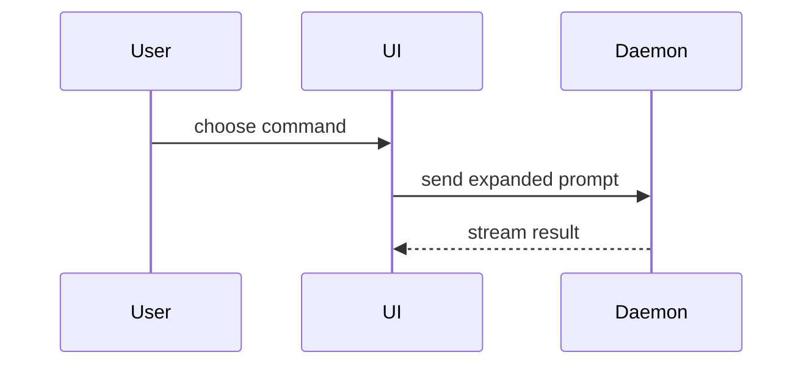

# Visual outline for "Qué hay de nuevo?"

The section is a compact structural view of the change, not prose or a file-by-file changelog. Use the smallest
combination of views that explains the implementation, each preceded by one short sentence (in the PR language)
saying what it shows. Tell the story in the order that makes it easiest to understand: sometimes the file tree first,
sometimes a data structure, SQL table or API contract first. Name and order views based on the change, not a fixed
template. Omit views for things that did not change.

## Choosing a view

- SQL table and endpoint contract changes: changed tables, important columns and relationships, request/response shapes.
- Key data structure / type changes.
- Business logic: concise pseudocode.
- File responsibility or a broad refactor: shallow file tree.
- UI structure: component tree, including important hooks, state and package boundaries.
- Runtime behavior: call tree, call stack, control flow or data flow.
- Interaction between components or services: Mermaid (GitHub renders it).

Use `diff` blocks when the point is what changes and the surrounding shape already exists. Show the complete target
shape in a language-specific or `text` block when most of it is new, high-level, or clearer without diff notation
(e.g. when omitted context would hide ownership or order). Keep only the calls, files, props, states, columns and
boundaries a reviewer needs.

## Examples

Pseudocode:

```text
on(save)
  if content is unchanged
    return cached result
  write new content
  return fresh result
```

Call tree:

```text
submitForm
  createSession
    persistPrompt
    launchAgent
  navigateToSession
```

Component tree with state and module boundaries:

```tsx
<SessionPage> (apps/example/src/routes/session.tsx)
  useSessionEvents()
  <SessionToolbar>
    <RunSkillButton> (packages/ui)
```

Shallow file tree:

```text
src/
├── commands/       # parses user actions
├── sessions/       # owns session state
└── transport/      # sends API requests
```

Mermaid for interaction or data flow:



Diff of a component tree:

```diff
 <SessionPage>
   useSessionEvents()
   <SessionToolbar>
+    <RunSkillButton />
   <SessionTimeline>
+    <SkillResultCard />
```

Diff of a file layout:

```diff
 src/
 ├── commands/
+│   └── show-me.ts       # expands the slash command
 ├── sessions/
-└── transport.ts
+└── transport/
+    ├── client.ts
+    └── stream.ts
```

Diff of a call tree:

```diff
 submitForm
   createSession
     persistPrompt
+    expandSkillMention
     launchAgent
-  navigateToSession
+  navigateToSession
+    subscribeToEvents
```

Diff of control flow:

```diff
 on(save)
-  write content
+  if content is unchanged
+    return cached result
+  write new content
+  invalidate cache
```

Diff of a table or contract:

```diff
 CREATE TABLE payments (
   id          uuid PRIMARY KEY,
   amount      bigint NOT NULL,
+  refunded_at timestamptz,
-  status      text
+  status      payment_status NOT NULL
 );
```

Complete target shape when mostly new:

```ts
function expandSkill(command: string): string {
  const skillName = command.slice(1)
  return `use the ${skillName} skill`
}
```
